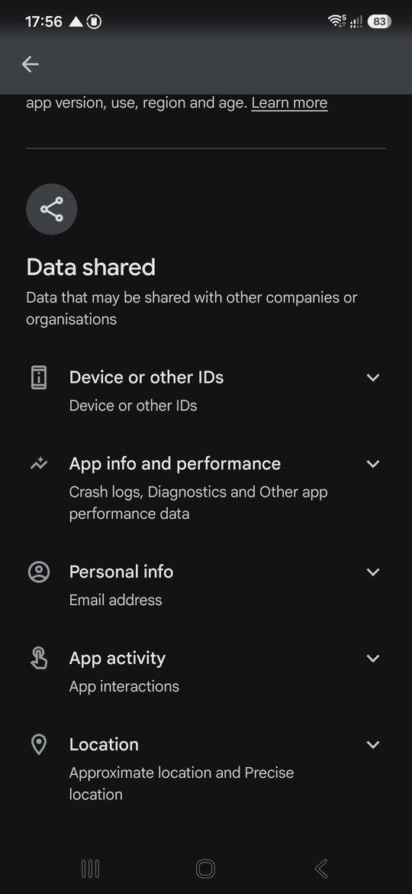
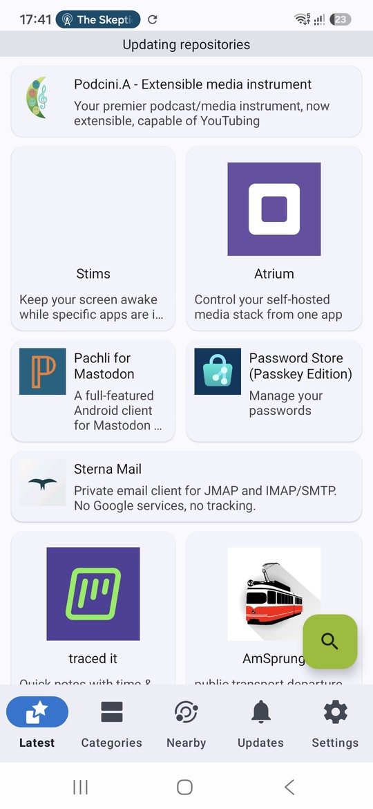
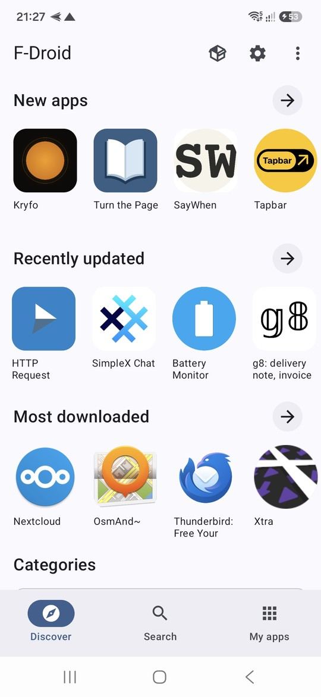

Before replacing any apps, we need a place to get the replacements from. Most of the privacy-friendly apps I'm going to recommend in this section are available in the Google Play Store. Some of them aren't, or the app is not exactly the same. Reasons differ: some apps wouldn't be allowed by Google, sometimes it's the developer's decision.

Of course you can download any app directly from the developer's website. But that's inconvenient, makes it hard to update and increases chances of accidentally installing malware. Once you're used to the comfort of an app store, you don't want to go back. Which is why my preferred way is an alternative store.

## Why F-Droid

F-Droid is an alternative app store for Android, running since 2010. It is known for strict enforcement of some rules - which Play Store is also known for, but the rules are very different.

- **Only open source apps.** Every app in the main repository has its source code publicly available, under an open source licence.
- **F-Droid builds the apps itself.** Developers don't upload ready-made APK files. F-Droid takes the source code and builds the app on its own servers, so what you install is actually built from the published code. For some apps the builds are reproducible.
- **Anti-features are clearly labelled.** F-Droid has a concept of anti-features, meaning something most users don't want: tracking, ads, dependency on non-free network services, non-free components. Those are sometimes allowed (depending on the details) but clearly marked. Apps that don't use trackers and Google libraries are preferred.
- **No account.** You don't need to log in to install, F-Droid doesn't track what apps you use.

The client can also use repositories other than the official one. Some developers host their own F-Droid repositories, and there are third-party ones like IzzyOnDroid, with less strict rules. But I'll focus on the default repo.

## Why is it important

As described in the [intro](/android/intro/), Google controls most of the Android ecosystem through Play Services and the Play Store. F-Droid is the biggest independent alternative to that.

Apps on F-Droid are guaranteed to come without trackers and ads (unless they're clearly labelled). There are many popular categories on Play Store: calculators, timers, wallpaper rotators, camera filters, weather reports - notorious for apps collecting much more data than they need to function. Of those above, only a weather app might need your location and none should request your contacts or email address - and yet, they often do. Sure, you can find privacy-friendly apps on Play Store, but good luck browsing through hundreds of them checking what data they collect. On F-Droid, it's simple.

Sometimes the same app is available in both stores, but one comes with Google trackers and one without them. Both stores enforce their rules, but their goals are different.

Some apps are not available in Play Store because they are against Google's terms of service. This is always a reason to be careful, but not necessarily a red flag. Of course Google doesn't allow malware (and does a pretty good job of preventing it) and apps that are too invasive even by Big Techs' standards. But it also doesn't allow apps that might be beneficial to users, but interfere with Google's business: adblockers, alternative clients for Google services.

## Downsides

- **Updates are slower.** Because F-Droid builds everything itself, new versions usually appear with a delay of a few days, sometimes longer, compared to the Play Store or developers' websites.
- **Different signatures.** Apps built and signed by F-Droid can't update the same app installed from the Play Store (and vice versa). There are some exceptions, but usually if you want to switch an app's source, you need to uninstall it first - so back up its data before doing that.
- **The selection is limited.** Only open source apps, so no banking apps, no usual social media or streaming services etc. F-Droid is a complement to the Play Store for most users, not a full replacement. Plus, many of the apps are not as polished as their commercial equivalents, especially when it comes to UI. 
- **You still need to trust someone.** Instead of trusting Google, you trust F-Droid's build infrastructure and signing keys.

## How to install it

F-Droid is not available in the Play Store, so it has to be installed from its website. This is known as "sideloading":

1. Open [f-droid.org](https://f-droid.org) in the browser on your phone and tap Download F-Droid. **Download it only from the official site** - there are fake "F-Droid" apps out there.
2. Open the downloaded file. Android will warn you that your browser is not allowed to install unknown apps. Tap **Settings** and enable **Allow from this source**, then go back and tap **Install**.
3. Open F-Droid. On first launch, it downloads the app index from the repository, which can take a few minutes.
4. When you install your first app, Android will show the same warning again, this time for F-Droid itself - allow it to install apps the same way.
5. For security, go back to **Settings > Apps > Special app access > Install unknown apps** (the exact path differs between phones) and revoke the permission from your browser. F-Droid needs it permanently, the browser shouldn't have it. It's not a standard practice on Android to sideload apps, so the extra step is useful to prevent accidental installation.

### If you come here from the future: Google's developer verification

Google is introducing developer verification: on certified Android phones, apps installed from outside the Play Store must come from developers registered with Google. This is a direct threat to F-Droid, which builds and signs most of its catalogue itself, from developers who often refuse to register with Google. F-Droid strongly opposes it and supports the [Keep Android Open](https://keepandroidopen.org) campaign.

The enforcement started on 30 September 2026, but only in Brazil, Indonesia, Singapore and Thailand. If you live elsewhere, nothing changes yet. But a global rollout is planned for 2027.

Where the rules apply, Google has added an "advanced flow" for experienced users who want to install unverified apps anyway:

1. Enable Developer Options (tap the build number in **Settings > About phone** seven times).
2. In **Developer Options**, find the setting for allowing apps from unverified developers and enable it.
3. Confirm with your PIN or password, confirm that nobody is pressuring you into doing this, and restart the phone.
4. Wait 24 hours. Yes, really - it's meant to break scams where victims are tricked into installing malware on the phone. Or to make it hard to use Google-free alternatives.
5. Go back to the setting and choose whether to allow unverified apps for seven days or indefinitely.

It's a one-time process, after that installing apps works normally. Installing apps from a computer over ADB is not affected at all. Phones with custom OSes are not "certified", so the rules don't apply to them either.

## F-Droid 2.0

On 24 September 2026, F-Droid released version 2.0 of its client - the biggest update of the app in 10 years. The old F-Droid client looked dated and was sometimes awkward to use, so the redesign was more than welcome.

- **Rewritten UI** is the most visible change. It now looks like a modern Android app.
- **Simpler navigation**, with just three sections: Discover, Search and My Apps.
- **Better search**, which now also looks into app descriptions, categories and translations, supposedly has much better support for Chinese, Japanese and Korean (I didn't test it, since I speak none of them), and remembers recent queries.
- **Automatic updates by default.** F-Droid now downloads and installs app updates on its own, using Android's newer installer APIs. Ironically, these became available thanks to the EU's Digital Markets Act and antitrust pressure on Google. On newer Android versions, you also confirm an installation right when you tap install, not after the download finishes.
- **Independent security review**, done by the Open Technology Fund's Security Lab together with Convocation. The results weren't published yet.

I've used F-Droid for years and it always updated itself, but this time it showed that the update is not compatible. Perhaps because it was the major rewrite. I had to manually download the APK from the F-Droid website.

## Next steps

With F-Droid installed, we have a source of trustworthy apps. In the next posts, I'll go through specific apps worth replacing.

## Sources

- [F-Droid 2.0: a new chapter for Android freedom](https://f-droid.org/en/2026/09/24/f-droid-2.0-a-new-chapter-for-android-freedom.html) - official announcement
- [Get F-Droid](https://f-droid.org/docs/Get_F-Droid/) - official installation docs
- [F-Droid Rebuilt Its App Store Right as Android Locks Down Sideloading](https://pinggy.io/blog/f_droid_2_0_android_developer_verification/) - Pinggy
- [Google's advanced flow for sideloading starts rolling out](https://www.androidauthority.com/google-android-advanced-flow-sideloading-rollout-begins-3700073/) - Android Authority
- [Google adds 24-hour wait for unverified apps](https://thehackernews.com/2026/03/google-adds-24-hour-wait-for-unverified.html) - The Hacker News
- [F-Droid 2.0 continues updating despite Google's pending developer verification plan](https://news.slashdot.org/story/26/09/25/0344225/f-droid-20-foss-android-appstore-continues-updating-despite-googles-pending-developer-verification-plan) - Slashdot
- [F-Droid isn't ugly anymore: the open-source app store gets its biggest update in a decade](https://www.howtogeek.com/f-droid-isnt-ugly-anymore-biggest-update-in-a-decade/) - How-To Geek
