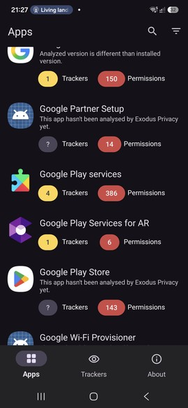
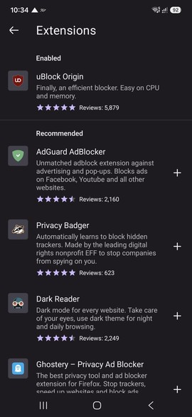
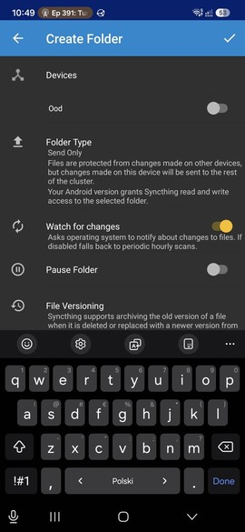
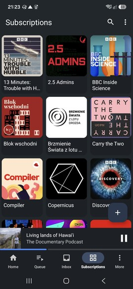
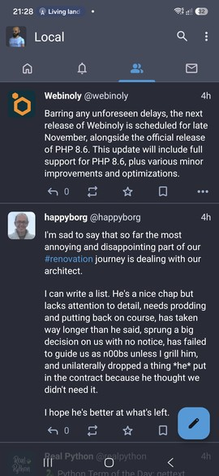
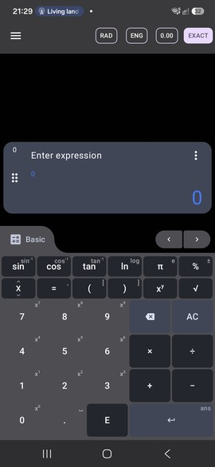
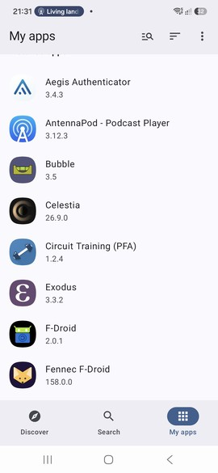

With [F-Droid](/android/f-droid/) installed, it's time to actually use it. F-Droid has thousands of apps, so here's my shortlist of ten. I picked them using two criteria: either they make the biggest difference for privacy, replacing an app that collects a lot of data about you, or they're simply not available in the Play Store (or only in a crippled version).

In many cases they can replace a popular, privacy-invasive app. Sort of. Replacing an app made by a company with thousands of developers with one made by a handful of volunteers usually means giving up something. I'll list the **limitations**. In some cases I keep both the privacy-friendly and privacy-unfriendly app installed. I use the open-source app by default and only if it can't do the job, I use the other one. That way, at least I leak only part of my data. I'll also suggest **alternatives** - the main recommendation is my preferred balance between privacy and effort, YMMV.

## 1. Exodus to check what's inside your apps

Before replacing anything, it's good to know what you're replacing. [Exodus Privacy](https://exodus-privacy.eu.org/) is a non-profit that analyses Android apps and lists the trackers and permissions they contain. Search for an app on their reports page and you'll see which tracking companies (Google Firebase, Facebook, ad networks etc.) are built into it, and which permissions it asks for.

The Exodus app does the same for all the apps installed on your phone. It's often eye-opening: popular apps commonly have several trackers, while the F-Droid ones below usually have none (or mostly harmless ones, like crash reporting).

**Limitations:**

- **It's a static analysis.** It shows what trackers are in the code, not what data is actually sent, or when. A tracker library might be included but barely used - or the app might send data to its own servers, which Exodus doesn't detect. It's a good first indicator, not a full picture.

**Alternatives:**

- **Exodus from Play Store** is, as far as I can tell, the same app - useful if you don't use F-Droid (yet).
- **TrackerControl** is more powerful. Instead of static analysis, it monitors network connections of each app. It's available in both stores, but the F-Droid version can also block tracker requests.

## 2. NewPipe instead of the YouTube app

[NewPipe](https://newpipe.net/) is an alternative YouTube client that doesn't use Google Play Services or any YouTube API. It just reads the YouTube website, the same way your browser would. It can do things the official app can only do with a premium subscription: playing in the background, picture-in-picture. I often use it when I'm only interested in audio. You can subscribe to channels and create playlists - all stored locally on the phone. It also supports other sources like SoundCloud, PeerTube, Bandcamp and media.ccc.de.

It's not available in the Play Store, as it breaks Google's terms of service. Beware: there are fake "NewPipe" apps there, some of them being the real app with ads added. Get it from F-Droid only.

**Limitations:**

- **It breaks regularly.** YouTube tries to block alternative clients. Sometimes there's a bigger change to the YouTube website and it breaks NewPipe completely. The fixes usually come within days, but for those days the app is useless [^1]. Other times it plays most videos, but crashes on a specific one. 
- **No account features.** You can't log in, so no comments, no likes, and subscriptions are stored locally (not synced with other devices). You also can't access YouTube Premium videos, age-restricted content is theoretically supported in new versions but mostly doesn't work.

**Alternatives:**

- If you feel even more rebellious, there's a fork called [PipePipe](https://github.com/InfinityLoop1308/PipePipe), also available on F-Droid. It includes SponsorBlock (automatically skipping sponsored segments in videos), keyword and channel filters, the return of the dislike button. Downside: since it's a smaller project with few developers, and yet it aims to add more features, it seems to be less stable (although I couldn't find any hard data on it and some users claim it crashes less often).

## 3. Fennec instead of Chrome

[Fennec F-Droid](https://f-droid.org/packages/org.mozilla.fennec_fdroid/) is a Firefox build with proprietary components and telemetry removed. That alone would be a good reason to switch from Chrome, which is tied to your Google account and to Google's ad business. But the most important feature is extensions: like the regular Firefox, Fennec supports add-ons, including **uBlock Origin**. Chrome for Android doesn't support extensions at all, and on desktop Google has crippled ad blockers with Manifest V3. An ad blocker in the browser is probably the single biggest privacy improvement you can make on a phone - and it makes the web noticeably faster too.

**Limitations:**

- **Not completely "clean".** F-Droid flags it with the *tracking* anti-feature, because it still connects to some Mozilla services. It's much better than Chrome, but not perfect. There are other, more hardened Firefox forks.
- **Compatibility.** It doesn't happen often, but some websites only work in Chrome. Extensions can also cause issues: in 2025, a Fennec update made pages load extremely slowly with uBlock Origin enabled, until it was fixed [^2].

**Alternatives:**

- Regular **Firefox** is not so bad either. Even with the recent privacy controversies [^3], I still rate it higher than Chrome. The uBlock itself makes it worth to migrate. If you don't use F-Droid, that's the way to go.
- I don't use **Brave**, despite the privacy hype around it. Some early issues - replacing ads with their own, adding affiliate codes to the URLs, promoting cryptocurrency, selling search data for AI training [^4] - put me off. Even with all those fixed, I'm highly distrustful of the project.

## 4. Aegis instead of Google or Microsoft Authenticator

All TOTP (Time-based One-Time Password) apps work the same, based on an open standard. So there's no reason to use one that's tied to your online account and controlled by one of the Big Tech. Open source alternatives are not a compromise - they're equally good.

[Aegis Authenticator](https://getaegis.app/) keeps everything in an encrypted vault on the phone, protected by a password or fingerprint. It can create automatic encrypted backups to a location you choose - including a self-hosted cloud. Codes can be organised into groups, and it can import from many other authenticator apps.

To move from Google Authenticator: in Google Authenticator, choose **Transfer accounts > Export accounts**. It shows a QR code (screenshots are blocked), so you need a second device to show the code, and scan it with Aegis. If you have many accounts, export them in smaller batches (around 6 at a time), as Aegis can have problems reading very dense QR codes.

**Limitations:**

- **No cloud sync by default.** Google Authenticator saves data in the cloud if you're signed in to your Google account. In Aegis you need to enable backup (to a location that's synced - see point 6 below). Which is only a few clicks, but you need to do it (preferably, right now). If you lose the phone and don't have a backup, you lose access to your accounts.
- **The migration is a bit tedious**, if you already have many accounts in another app. Not really a limitation of Aegis, which does a great job importing, it's the exporting part that's hard.
- **No push notifications for Microsoft accounts.** Microsoft Authenticator can do passwordless sign-in with a single tap on a notification. That's a proprietary Microsoft mechanism, not TOTP. You can configure your MS account to use TOTP instead and that works with Aegis, but it's less convenient. Personally, I use MS Authenticator for the MS account only and Aegis for everything else.

## 5. KeePassDX instead of in-browser password manager

Most people - or at least, most of those few people who don't use the same simple password everywhere (see my [Hashcat experiment](/homelab/hashcat/) if you're not one of them) - save their passwords in their browser. In the case of Chrome, that's Google Password Manager. It's relatively safe under normal conditions. The biggest problem: it's the prime target of malware. Extracting data from Google Password Manager is the second thing that a typical malicious program does (first is disabling antivirus on Windows). Plus, it's one more thing that ties you to Google, which is wrong on general principles. And it's very easy with Chrome, but awkward with other browsers or for passwords you need to enter somewhere else.

Next step is a cloud-based password manager. If properly written, such products don't expose your passwords to the provider. Some of them had independent audits and a good security history (e.g. BitWarden, 1Password), some had not so great history (LastPass comes to mind). But I prefer not to rely on the cloud for such an important service. **KeePass** has long ago been a de-facto standard for offline password managers. The original is built on .NET, it only works well on Windows (it can work on Linux and MacOS with Mono, but it feels clunky). The UI looks dated and the development is slow. Which is why the clones are now more popular: **KeePassXC** for Windows, Linux and MacOS, **KeePassDX** on Android (and a few others). They all share the same DB format, so you can mix them any way you like[^5].

**Limitations:**

- **No built-in sync.** KeePass and friends don't sync the DB to a cloud. That's intentional - no network code means smaller attack surface, and the DB is only one file, so it's easy to copy it externally. Just place it in a location that's synced between your devices. More on that later.
- **Database conflicts between the devices.** That's directly related to the previous point. If you modify the DB on 2 devices before they are synced, the syncing app has no way to merge the changes. KeePassDX (or XC, or other clones) can easily do it, but it's a manual step.
- **Harder to use than passwords saved in the browser.** It's not really THAT hard, but many people are reluctant to even try. True, there is some effort to set everything up: install apps on all your devices, configure browser plugins, sync the DB. But once you get it working, it's only marginally harder to use, while being way more secure and adding tons of features.

**Alternatives:**

**KeePassDX from Play Store** is exactly the same app. At least at the time of writing: same version, same permissions etc. Not the same binary of course.

**BitWarden** is a good choice if you prefer a cloud-based password manager. It's regularly audited and has a good security history (there were some issues, but minor and quickly fixed). You can even self-host a BitWarden server. I prefer an offline app, but you do you.

## 6. Syncthing-Fork instead of Google Drive or Dropbox

[Syncthing](https://syncthing.net/) synchronises folders directly between your devices - phone, laptop, NAS - without any cloud in the middle. Devices find each other, connect over an encrypted connection, and keep the chosen folders identical on all of them. No account, no storage limit, no company that can read (or lose) your files. It's open source and available for Windows, Linux, MacOS, Android and some other systems. I covered the setup in more detail in the [Syncthing post](/home/syncthing/).

It's the missing piece for KeePassDX: put the database in a synced folder, and every change you make on one device shows up on all others. But obviously it works for everything else you want synced: documents, notes, important backups. I have a small set of documents that I keep on my phone, in addition to the computers. My phone also does a one-way copy of photos to my laptop.

On Android, you need **Syncthing-Fork**. The official Syncthing Android app was discontinued at the end of 2024, and the fork, which already had extra features, improved GUI and better battery handling [^6], became the only way to run it. If you have the old Syncthing app, it still works, but it can't be installed from app stores anymore. Unfortunately, there's no migration path if you decide to move to Syncthing-Fork, you need to configure the synced folders and devices again. 

**Limitations:**

- **Devices have to be online at the same time.** There's no cloud server holding the files, so the phone and the computer can sync only when both are on and connected. The easy fix is an always-on device, like a home server, which acts as a central point.
- **Possibly LAN only (depending on the setup).** I decided to use my home server to sync all other devices. It feels very safe, but it's annoying when I go on holiday with my laptop and phone and they can't sync anymore. I could run Syncthing on my VPS instead, or I could use a VPN. I might one day. Full disclosure: I still use Google Drive for stuff that's low security but needs to be synced on the go, such as travel tickets.
- **Conflicts.** If you edit the same file on two devices before they sync, you get a second file with `sync-conflict` in its name, and you have to merge them yourself. Rare, but it happens.
- **It's not a backup.** Deleting a file on one device deletes it everywhere. You can enable file versioning per folder, but you should still have a real backup.
- **Battery and background restrictions.** To sync in the background, it needs an exception from battery optimisation. You can limit it to Wi-Fi only or to charging, which helps with the battery, but delays syncing.
- **The Android app's future is a bit uncertain.** In 2025 the fork changed maintainers, with little explanation, which caused some worry in the community. It's still actively developed, but it's worth keeping an eye on.

**Alternatives:**

- **Syncthing-Fork from Play Store** is, as far as I can tell, exactly the same app. Both versions show no trackers. They do show some scary permissions, but they are all justified (file access - which is fine-tuned to specific folders, running in the background, location). 
- If you already self-host **Nextcloud**, its Android app can do the same job.

## 7. AntennaPod instead of Spotify or other streaming services for podcasts

Most podcasts are published by their authors on their websites, with RSS feeds to inform about new episodes. There's no need for a middleman like Spotify or another streaming service. There are tons of apps that work the old-fashioned way: read the feed, download the MP3 files and let you play them even when you're offline. AntennaPod is one of them. Compared to better-known commercial alternatives such as Podkicker or PodcastAddict (which show ads, with all the tracking that comes with them, unless you pay for an ad-free version), it's not a compromise at all, it has a very similar set of features. You can search for podcasts, import subscriptions from other apps (OPML), download episodes automatically, change playback speed, skip silence, set a sleep timer. Optionally, it can sync subscriptions and progress with a gpodder.net or Nextcloud server.

**Limitations:**

- **No exclusive content.** Podcasts exclusive to Spotify, or only published as videos on YouTube, won't be available. That's not AntennaPod's fault, but it's a limitation.

**Alternatives:**

- **AntennaPod from Play Store** is, again, the same app.

## 8. Phonograph Plus instead of Spotify or other streaming services for music

I'm afraid I'm revealing my age now, but I keep a collection of MP3 files instead of using a streaming service. That means my music won't disappear one day, or won't be replaced by another version [^7].

There was a time when every smartphone (and dumbphone before) came with a simple audio player. Today, if there is one, it's anything but simple. I checked a few on F-Droid and I liked Phonograph Plus. It has everything I expect from a music player (browsing and searching by multiple categories, playlists, queue management, lyrics, tag editor, widgets and Android Auto support) without feeling heavy or overwhelming. It's licensed under GPL-3.0.

It's not available in the Play Store - only on F-Droid and GitHub.

**Limitations:**

- **Local files only.** Obviously. I'm either in "discover new music" mode, when I have to use something else, or "listen to what I know in the background" mode.
- **Small project.** It's mostly developed by one person, so the future depends on their free time.

**Alternatives:**

There are many similar, light players, so it's mostly a matter of personal preference.

- **Fossify Music Player** - part of the Fossify suite (see Honourable mentions), simple and lightweight. Available in both F-Droid and Play Store.
- **Gramophone** - a modern-looking player with Material You design. Available in both F-Droid and Play Store.
- **Auxio** - another modern player, focused on correct handling of metadata (tags). F-Droid only.

## 9. Tusky instead of X and Facebook

Tusky is a client for Mastodon, the best-known part of the Fediverse - a network of independent servers that talk to each other, so you can follow people on other servers, much like email works between providers. There's no single company owning it, no algorithm deciding what you see (the timeline is chronological, you only see posts from people you follow) and no ads. You can pick a server run by someone you trust, or even self-host your own. Tusky is one of many Mastodon clients. It's light, supports multiple accounts, filters, scheduled posts, drafts and content warnings. It's licensed under GPL-3.0.

**Limitations:**

- **Your friends probably aren't there.** That's the real problem with any alternative to big social networks. I'm still on Facebook, for my normie friends (I'm not on X, which I find more toxic than other social networks). On Mastodon, I mostly talk with open-source developers, electronics enthusiasts etc. I noticed that despite only interacting with a few people, I had quite a lot of interesting conversations.
- **Confusing for newcomers.** There's an extra step that's different from other social networks: you need to select a server. Servers have different policies, admins can moderate according to different rules. You can move your account to another server, though.

**Alternatives:**

- **Tusky from Play Store** is the same app.
- **Mastodon** - the official app. Available in both F-Droid and Play Store.
- **Moshidon** - a fork of the official app with extra features. F-Droid only.
- **Fedilab** - supports more Fediverse platforms (Mastodon, plus compatible ones such as Pleroma, Akkoma and Friendica). Play Store version is crippled.

## 10. Qalculate instead of calculators that are after your data

Everyone needs a calculator. If you're an engineer or you're cosplaying one, you sometimes need a scientific calculator. Qalculate is even more than that - it can do symbolic maths.

The Android app is a port of [Qalculate!](https://qalculate.github.io/), a well-established desktop calculator for Linux, Windows and MacOS. You can use it like a simple calculator, but also you can type the whole expression. You can use it for symbolic calculations: simplifying expressions, solving equations, derivatives and integrals. You can use units in the formulas and convert between them. Still not enough? There are also physical constants, currency conversion, uncertainty propagation, interval arithmetic and a large library of functions. It's licensed under GPL-2.0.

Compare that with the calculators preinstalled by some phone manufacturers, or the popular ones in the Play Store, which often show ads and ask for permissions that a calculator has no business having.

**Limitations:**

- **It's a young app.** The desktop Qalculate! has been around for 20 years, but the Android port is still at version 0.x. The engine is mature, the interface less so.
- **Overkill for simple sums.** If you only need to split a restaurant bill, a simple calculator is quicker. The typing-based interface takes some getting used to.
- **Currency conversion needs the internet.** Exchange rates have to be downloaded, everything else works offline.

**Alternatives:**

- **HiPER Scientific Calculator** - if you don't use F-Droid, this is the scientific calculator worth considering. It's not open source and it's only in the Play Store, but it's feature-packed (fractions, complex numbers, equation solver, unit conversion and much more). There's a free version with tracker and ads, and a paid version that doesn't collect user data (except for device ID) and has some extra features.
- **Qalculate! on desktop** - not an Android alternative, but if you like the app, get the desktop version too (GTK or Qt GUI, or `qalc` in the terminal). Same engine, same syntax.
- **Fossify Calculator** - part of the Fossify suite (see Honourable mentions). A simple, button-based calculator for everyday use. Available in both F-Droid and Play Store.

## Honourable mentions

There are tons of simple apps who have no need to know my location, email or contacts, and yet they try to do exactly that. Good luck finding a privacy-friendly app on Play Store. On F-Droid it's easy.

- **Bubble** - bubble level/inclinometer. I use it occasionally for home renovation when I can't find the real bubble level.
- **Circuit Training** - an interval timer, for Tabata training or anything that needs several timers in a row.
- **Fossify** - a whole suite of simple apps (gallery, file manager, calendar, contacts, SMS, phone).
- **Image Toolbox** - an image editor with batch functionality. Useful if you want to resize multiple files, strip EXIF, add a watermark. It can also stack images or make a collage. In a pinch, it works as a single-photo editor, but it's not the most convenient.
- **Markor** - lightweight text editor with Markdown support.
- **Network Survey** - shows info on Wi-Fi, Bluetooth, GPS and cellular connections.

## Sources

[^1]: NewPipe problems:
- [NewPipe not loading videos: what's going on](https://tecnobits.net/newpipe-not-loading-videos-heres-whats-going-on-and-how-to-fix-it/) - TecnoBits

[^2]: Fennec problems:
- [Fennec 142 takes several minutes to load websites with uBlock Origin](https://forum.f-droid.org/t/fennec-142-takes-several-minutes-to-load-websites-when-using-ublock-origin-or-privacy-badger-or-ghostery/33120) - F-Droid forum

[^3]: Firefox privacy controversies:
- [Firefox tracks you with "privacy preserving" feature](https://edri.org/our-work/firefox-tracks-you-with-privacy-preserving-feature/) - EDRi (Privacy Preserving Attribution, 2024)
- [Mozilla buys Anonym, betting privacy is compatible with ads](https://www.theregister.com/2024/06/18/mozilla_buys_anonym_betting_privacy/) - The Register (2024)
- [Mozilla responds to backlash over new terms, saying it's not using people's data for AI](https://techcrunch.com/2025/02/28/mozilla-responds-to-backlash-over-new-terms-saying-its-not-using-peoples-data-for-ai) - TechCrunch (2025)
- [Firefox responds to AI backlash by promising a 'kill switch'](https://techradar.com/computing/firefox-responds-to-ai-backlash-by-promising-a-kill-switch-for-turning-off-controversial-new-features) - TechRadar (2025)

[^4]: Brave controversies:
- [Brave browser is collecting donations on your behalf - did you know?](https://www.theblock.co/post/5839/brave-browser-is-collecting-donations-on-your-behalf-did-you-know) - The Block (tips collected for creators without their consent, 2018)
- [Brave's browser has been autocompleting websites with referral codes](https://www.theblock.co/post/67594/braves-browser-has-been-autocompleting-websites-with-referral-codes) - The Block (affiliate codes in the address bar, 2020)
- [Brave browser's Tor mode exposed users' dark web activity](https://www.welivesecurity.com/2021/02/22/brave-browser-tor-mode-exposed-dark-web-activity/) - WeLiveSecurity (.onion DNS leak, 2021)
- [Brave browser under fire for alleged sale of copyrighted data](https://www.searchenginejournal.com/brave-browser-under-fire-for-alleged-sale-of-copyrighted-data/491854/) - Search Engine Journal (Search API data for AI training, 2023)
- [Brave browser under fire for installing its VPN without user permission](https://www.techradar.com/pro/vpn/brave-browser-under-fire-for-installing-its-vpn-without-user-permission) - TechRadar (2023)

[^5]: KeePass clones compatibility - there are some caveats about version formats (avoided if you use recent versions, which you should anyway), TOTP (which I recommend to keep outside of the password manager) and some other uncommon features. In real life, you're unlikely to encounter them. See here if you're curious: 
- [KeePassXC Documentation and FAQ](https://keepassxc.org/docs/) - KeePassXC (YubiKey incompatible with KeePass 2, no plugins, supported KDBX versions)
- [KeePass KDBX Compatibility: Apps & Versions](https://www.panicvault.org/keepass/compatibility-guide/) - PanicVault (per-app matrix: Twofish, YubiKey, TOTP, KDBX 3.1 vs 4.0)

[^6]: Syncthing on Android:
- [Syncthing for Android is being discontinued, but there's an alternative app](https://www.ghacks.net/2024/10/21/syncthing-for-android-is-being-discontinued-but-theres-an-alternative-app-you-can-switch-to/) - gHacks (2024)
- [Does anyone know why syncthing-fork is no longer available on Github?](https://forum.syncthing.net/t/does-anyone-know-why-syncthing-fork-is-no-longer-available-on-github/25661) - Syncthing forum (maintainer change, 2025)

[^7]: Music removed or replaced on streaming services:
- [Taylor Swift shakes off Spotify, pulls entire catalog](https://www.engadget.com/2014-11-03-taylor-swift-spotify-break-up.html) - Engadget (2014, back in 2017)
- [Kanye just changed an album that's been out for four months](https://www.mtv.com/news/1u5bou/kanye-west-updates-the-life-of-pablo-saint-pablo) - MTV (The Life of Pablo modified after release, 2016)
- [Neil Young removes music from Spotify in protest of Joe Rogan's podcast](https://variety.com/2022/music/news/neil-young-spotify-joe-rogan-1235164458) - Variety (2022, back in 2024)
- [King Gizzard and the Lizard Wizard to pull music from Spotify over Daniel Ek's A.I. investments](https://www.thefader.com/2025/07/28/king-gizzard-spotify-boycott) - The Fader (2025, followed by Massive Attack, Deerhoof, Xiu Xiu and others)
- [Spotify posting AI-generated songs of dead artists without permission](https://musictech.com/news/music/spotify-ai-generated-songs-dead-artists/) - MusicTech (fake songs on Blaze Foley's and Guy Clark's profiles, 2025)
- [Songs on playlists being automatically replaced](https://community.spotify.com/t5/Your-Library/Songs-on-playlists-being-automatically-replaced/td-p/5301134/highlight/true/page/2) - Spotify Community (tracks swapped for live, remastered or re-recorded versions)
