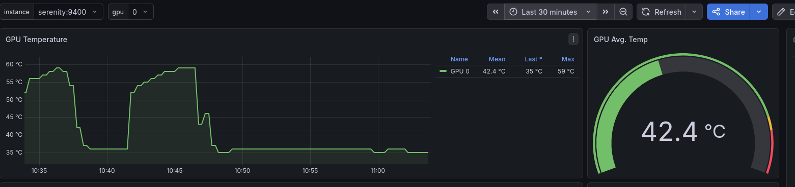

In [part 1](/homelab/coding-agent-1/) I went through the options. Now it's time to put it all together and see whether it can do any useful work.

## Dress rehearsal on Serenity

The L40S costs $3.54 per hour. I still have free credits, but I don't want to spend them on reading error messages and fixing typos in config files. As with [vLLM](/homelab/vllm/) and [TensorRT-LLM](/homelab/tensorrt-llm/) before, I'm testing the whole stack on Serenity first.

A chatbot on RTX 3050 was bordering on practical. A coding agent won't be. My GPU has 6GB of VRAM, I need to leave much of it for KV cache, so the model has to be tiny. But that's not the point. The goal is to get every command and config file right so I won't waste time with the VM.

The stack I'm testing:

- **vLLM** in Docker, serving the model on port 8000.
- **SearXNG** in Docker, on port 8888.
- **mcp-searxng** - the adapter between Pi and SearXNG. Pi starts it on its own when it needs it.
- **Pi** itself, running directly on the host.

### Choosing a tiny model

I wanted a model as close to the real one as possible. Qwen3.6 only comes in 27B and 35B-A3B sizes, but the previous generation, Qwen3.5, has small siblings: 0.8B, 2B, 4B and 9B. Same family means the same chat template, tool-call parser (`qwen3_coder`) and reasoning parser (`qwen3`). If those work with Pi at home, they will work with Qwen3.6 on the VM.

I went with **Qwen3.5-0.8B**. The bigger ones would need 4-bit quantisation to fit in 6GB with vLLM's overhead, and there are no official 4-bit builds of the small Qwen3.5 models - only community ones. The 0.8B version runs in the original BF16 precision, at about 1.8GB of weights, and leaves plenty of room for the KV cache. The RTX 3050 doesn't support FP8 anyway, so there's no way to test the quantisation I'm going to use on the VM.

Spoiler: even the 0.8B model managed to call tools correctly.

### vLLM and SearXNG

Both services in one Docker Compose file - the same file will go to the VM, with only the model lines changed.

```yaml
services:
  vllm:
    image: vllm/vllm-openai:latest
    restart: unless-stopped
    runtime: nvidia
    ipc: host
    ports:
      - "127.0.0.1:8000:8000"
    volumes:
      - hf-cache:/root/.cache/huggingface
    command:
      - --model=Qwen/Qwen3.5-0.8B
      - --served-model-name=qwen3.5-0.8b
      - --language-model-only
      - --gpu-memory-utilization=0.85
      - --max-model-len=32768
      - --max-num-seqs=2
      - --enable-auto-tool-choice
      - --tool-call-parser=qwen3_coder
      - --reasoning-parser=qwen3

  searxng:
    image: docker.io/searxng/searxng:latest
    restart: unless-stopped
    ports:
      - "127.0.0.1:8888:8080"
    volumes:
      - ./searxng/config:/etc/searxng
      - ./searxng/data:/var/cache/searxng

volumes:
  hf-cache:
```

Most of the vLLM parameters are explained in the [vLLM post](/homelab/vllm/). New ones:

- `--language-model-only` - Qwen3.5 and Qwen3.6 models have a vision encoder. I'm not going to send them images, so there's no point wasting VRAM on it.
- `--tool-call-parser=qwen3_coder` - as I wrote in part 1, the wrong parser doesn't fail to start. The model answers in prose and the agent waits forever for a tool call. This is the one recommended in vLLM's recipes for both Qwen3.5 and Qwen3.6.
- `--reasoning-parser=qwen3` - Qwen models think before answering. The parser moves the thinking into a separate field of the response, so the harness can show it (or hide it) instead of treating it as part of the answer.
- `--max-model-len=32768` - the bare minimum for a coding agent, as I wrote in part 1. Pi's system prompt and tool definitions alone take a few thousand tokens.
- `--max-num-seqs=2` - one user, one agent. No need to reserve memory for more.
- Both ports are bound to `127.0.0.1`. Neither vLLM nor SearXNG has any real authentication, and everything that talks to them runs on the same machine.

32K fits on the 3050 with a lot of room to spare. The weights take 1.53 GiB, and vLLM gives 2.66 GiB to the KV cache - 218,624 tokens, which is enough for 6.67 requests of the full 32K length at once. In total the GPU uses about 4.5GB of its 6GB.

SearXNG has one problem out of the box: the JSON API, which is all the agent needs, is disabled. It has to be enabled in `searxng/config/settings.yml`:

```yaml
use_default_settings: true

server:
  secret_key: "change-me"
  limiter: false

search:
  formats:
    - html
    - json
```

- `use_default_settings: true` - takes all the defaults and only overrides what's listed below. Without it, I'd have to copy the whole (very long) default config.
- `secret_key` - SearXNG refuses to start with the default one. `openssl rand -hex 32` generates a good one.
- `limiter: false` - the limiter is a bot protection for public instances. Here, the only "user" is a bot, and it's my own.

Start both and check that they respond:

```bash
docker compose up -d
curl -s localhost:8000/v1/models
curl -s 'localhost:8888/search?q=vllm&format=json' | head -c 500
```

If SearXNG returns `403 Forbidden`, the JSON format is not enabled.

The vLLM image was already on Serenity from the [vLLM post](/homelab/vllm/) (`latest` at that time, now version 0.27.1), so only the model had to be downloaded. Even so, it took about 7 minutes from `docker compose up` to the first answer:

- 143 seconds to download the model,
- 52 seconds of `torch.compile`,
- the rest is memory profiling, KV cache allocation and warm-up - 196 seconds for the whole engine initialisation.

The logs have some scary-looking lines that can be ignored: a warning that `--model=` will be removed in the future (the model should be given as a positional argument instead), and two `[ERROR]` lines about `min_frames` and `max_frames` missing from some docstring in the `transformers` library. They're not errors, just noise from the vision part of the model, which isn't even loaded.

### Testing tool calling without the agent

Before adding Pi to the mix, I checked that vLLM really returns tool calls, not prose. A single request with one fake tool:

```bash
curl -s localhost:8000/v1/chat/completions \
  -H 'Content-Type: application/json' \
  -d '{
    "model": "qwen3.5-0.8b",
    "messages": [{"role": "user", "content": "What is the weather in London?"}],
    "tools": [{
      "type": "function",
      "function": {
        "name": "get_weather",
        "description": "Get current weather for a city",
        "parameters": {
          "type": "object",
          "properties": {"city": {"type": "string"}},
          "required": ["city"]
        }
      }
    }]
  }' | jq '.choices[0].message'
```

The answer should have a `tool_calls` array with `get_weather` and `{"city": "London"}`, and an empty `content`. If the call is inside `content` as text, the parser is wrong.

And that's exactly what came back:

```json
{
  "role": "assistant",
  "content": null,
  "refusal": null,
  "annotations": null,
  "audio": null,
  "function_call": null,
  "tool_calls": [
    {
      "id": "chatcmpl-tool-aff582800ee584d6",
      "type": "function",
      "function": {
        "name": "get_weather",
        "arguments": "{\"city\": \"London\"}"
      }
    }
  ],
  "reasoning": null
}
```

The `reasoning` field is there, but empty - for a question this simple the model didn't think at all.

### Pi

Pi is written in TypeScript and needs Node.js 22.19 or newer. Serenity didn't have Node at all, and Debian 13's package is too old (20.19), so `apt install nodejs` wouldn't help. Pi installation script can install Node.js in the local directory and that's what I chose.

Pi recommends the usual `curl -fsSL https://pi.dev/install.sh | sh`. At least there's no sudo, but still, I downloaded the script first and had a quick glance.

The script installed Node v22.23.5 into `~/.local/share/pi-node/` and Pi itself into `~/.pi/agent/` (together with its own copies of `rg` and `fd`), with a `pi` symlink in `~/.local/bin/`. Node is not added to `PATH` - Pi finds it on its own, so it doesn't interfere with anything else on the machine.

Pi keeps its configuration in `~/.pi/agent/`. Three files there are relevant.

**`models.json`** - tells Pi where the model is. vLLM speaks the OpenAI Chat Completions API, which Pi supports out of the box:

```json
{
  "providers": {
    "vllm": {
      "baseUrl": "http://localhost:8000/v1",
      "api": "openai-completions",
      "apiKey": "none",
      "compat": { "thinkingFormat": "qwen-chat-template" },
      "models": [
        { "id": "qwen3.5-0.8b", "contextWindow": 32768, "reasoning": true }
      ]
    }
  }
}
```

- `id` has to match `--served-model-name` from the compose file.
- `apiKey` is a dummy - vLLM doesn't check it, but Pi only shows models from providers that have one.
- `contextWindow` - Pi knows nothing about a custom model, so it assumes 128K. vLLM only allows 32K, so without this Pi would happily keep growing the conversation past the limit instead of compacting it, and vLLM would start rejecting the requests.
- `reasoning` and `thinkingFormat` - by default Pi assumes a custom model can't think. These two tell it that it can, and how to switch the thinking on and off for Qwen models.

`pi --list-models` shows whether Pi picked it up:

```
provider  model         context  max-out  thinking  images
vllm      qwen3.5-0.8b  32.8K    16.4K    yes       no
```

**`mcp.json`** - the web search. mcp-searxng can run with `npx` (Node.js 22 or newer) or in Docker. I chose Docker, so I don't need to care about the Node version on the host:

```json
{
  "mcpServers": {
    "searxng": {
      "command": "docker",
      "args": ["run", "-i", "--rm", "--network", "host",
               "-e", "SEARXNG_URL", "isokoliuk/mcp-searxng:latest"],
      "env": { "SEARXNG_URL": "http://localhost:8888" },
      "exposure": "direct"
    }
  }
}
```

`--network host` is needed because SearXNG listens on the host's `127.0.0.1`, which is not reachable from a container on the default Docker network.

`"exposure": "direct"` is the most important line in this file, and it wasn't present in my first version - see below what happened without it.

`pi mcp list` connects to all configured servers and prints their tools - a quick way to check it works without starting a session. mcp-searxng has four: `searxng_web_search`, `web_url_read`, `searxng_search_suggestions` and `searxng_instance_info`.

```
searxng: connected, 4 tools (direct, global)
  docker run -i --rm --network host -e SEARXNG_URL isokoliuk/mcp-searxng:latest
  tools: searxng_web_search, searxng_search_suggestions, searxng_instance_info, web_url_read
  offers resources
```

The first run took 25 seconds, mostly downloading the Docker image.

**`extensions/`** - the permission gate. As I wrote in part 1, Pi runs every command without asking. On a disposable VM I can live with that, but Serenity is a real machine with real data. The example extension from the Pi repository asks for confirmation before `rm -rf`, `sudo` and `chmod 777`:

```bash
mkdir -p ~/.pi/agent/extensions
curl -fsSL -o ~/.pi/agent/extensions/permission-gate.ts \
  https://raw.githubusercontent.com/earendil-works/pi/main/packages/coding-agent/examples/extensions/permission-gate.ts
```

That's far from a proper guardrail, but better then nothing. For the rehearsal I also ran Pi in a fresh test directory, with no git credentials or API keys in the environment.

There's no need to enable the permission gate - Pi loads everything from `~/.pi/agent/extensions/` automatically. In non-interactive mode (`pi -p`), where there's nobody to ask, the extension simply blocks dangerous commands.

Finally, start it with the model selected:

```bash
mkdir -p ~/pi-test && cd ~/pi-test
pi --model vllm/qwen3.5-0.8b
```

### First tasks

For the tests I used Pi's non-interactive mode - `-p` takes the prompt, runs until the agent is done and prints the final answer. The first task was as simple as possible:

```bash
pi --model vllm/qwen3.5-0.8b -p "Create a bash script hello.sh that prints the current date and the hostname, make it executable and run it." </dev/null
```

```
The `hello.sh` script has been created and made executable. Here are its results:

- **Date:** Fri Nov 20 10:31:25 CET 2026
- **Hostname:** serenity

The script is at `/home/igor/pi-test/hello.sh` and is now runnable.
```

9.6 seconds, and the script is correct:

```bash
#!/bin/bash
echo "Date: $(date)"
echo "Hostname: $(hostname)"
```

I expected that a 0.8b model wouldn't even create a simple bash script. I was wrong.

The second task tested the web search:

```bash
pi --model vllm/qwen3.5-0.8b -p "Search the web: what is the latest released version of vLLM? Answer with the version number and the source URL." </dev/null
```

With the final config, it took 17 seconds and a single call of `searxng_web_search`:

```
**Latest released version:** vLLM 0.34.0 (released November 18, 2026)

**Source URL:** https://github.com/vllm-project/vllm/releases
```

The version and the URL are right. The date isn't: the search results say 16 November. Oh well, that's 0.8B model - no wonder it makes mistakes.

### What broke

I had a good intuition to do the rehearsal and fix the commands before trying the VM. vLLM and SearXNG worked on the first try, all the problems were on the Pi side:

- **Pi hung without doing anything.** My first `pi -p` run sat there for 10 minutes, without sending a single request to vLLM. When standard input is not a terminal, Pi reads it and adds it to the prompt - and over a non-interactive SSH session (or in a script), standard input never ends. Hence the `</dev/null` in the commands above.
- **The model didn't see the web search.** By default, Pi doesn't show MCP tools to the model directly. They are hidden behind a single `codemode` tool: the system prompt only says that a `mcp__searxng` server exists, and the model has to write a JavaScript snippet that finds the search tool and calls it. It's a clever way to save context when there are dozens of MCP tools, but the 0.8B model never figured it out. Instead, in 5 minutes it made 94 calls of `bash`: `curl` to made-up URLs, `pip search` (which doesn't exist, neither does `pip` on Serenity), `xxd`... and once tried to call a tool named `searxng`, which doesn't exist either. Then my timeout killed it. `"exposure": "direct"` in `mcp.json` makes Pi declare the tools to the model like the built-in ones - and the next run took 17 seconds. Like the wrong tool-call parser, this one doesn't fail loudly - the agent just tries to work around the missing tool. Good thing it was a 0.8B model, not smart enough to hack HuggingFace or Australian health service.
- **Pi didn't know the context window.** Without `contextWindow` in `models.json`, Pi assumes 128K for a custom model. Nothing broke during the short tests, but in a long session it would.

One more thing I noticed in the vLLM logs: `Prefix cache hit rate: 0.0%`. Prefix caching - reusing the computation for the part of the conversation that didn't change since the previous turn - is turned off for this model. During the failed search run, Pi sent 40 requests in 5 minutes, each with the whole conversation, growing to about 24K tokens. Every one of them was processed from scratch.

I checked the GPU usage on Grafana. I could clearly see the first attempt (the script and the failed search), few minutes debugging and the second attempt.



<!-- TODO: is prefix caching also off for Qwen3.6 on the VM? Check the "enable_prefix_caching" value in the engine config line of the vLLM log -->

### Files for the VM

Everything is ready to copy:

- `docker-compose.yml` - with the model lines changed,
- `searxng/config/settings.yml` - with a new `secret_key`,
- `~/.pi/agent/models.json` - with the new model ID and context window,
- `~/.pi/agent/mcp.json`,
- `~/.pi/agent/extensions/permission-gate.ts`.

Plus Pi itself, installed with the script, in a real terminal.

## On the rented GPU

With everything ready, I logged in to lightning.ai to start the VM - exactly at the moment when Lightning had some problems. The only message was "We're repairing some issues and getting things back up. Thanks for your patience." Studios were visible (I only had one, suspended), but no way to start it or create a new one..

Digging a bit deeper, I found that it on 16th of October, Lightning had a [security incident](https://lightning.ai/security-incident) - stolen credentials, after which they revoked access to the platform for all users. They also recommend rotating all secrets that were ever stored in a studio, like GitHub credentials - one more reason for a narrowly scoped token, BTW (I wasn't affected, since I only used it for experiments and didn't keep any secrets on it).

### Plan B: AWS

Since my usual provider was down for over a month, I didn't have much hope it will come back soon. I decided to use another one. I already had an AWS account, but on the free plan. The first surprise came right at the login: AWS wanted me to reset my password "for security concerns" (that was despite having 2FA with a TOTP app). There was no unusual activity on the account - in fact, no activity at all for a year or so - so maybe reactivating a previously dormant account seemed suspicious to their systems.

I upgraded to the paid plan, verified my card and set the monthly budget to $10 (that means warning, not a hard limit - I don't want to get a surprise invoice if I forget to power off the VM). Then I requested a quota increase to 4 vCPUs for GPU instances - because standard limit is exactly 0. A moment later I got a notification that the request requires manual approval, and a support case was created. 

It was quite an annoying process - so many steps just to run a short test. Now, I had to wait and see what happens sooner: AWS approves my quota request or Lightning comes back. Spoiler: AWS needed 2 hours and Lightning is still down at the moment of writing this.

I checked the prices in several regions, us-east-1 seemed to be the cheaper. Instance type g6e.xlarge should be enough. I also need extra disk space and a public IP, but that would only be a few cents per hours.

| Option | GPU | vCPU / RAM | $/h on-demand |
|---|---|---|---|
| AWS g6e.xlarge, us-east-1 | 1× L40S 48GB | 4 / 32 GiB, 250GB local NVMe | $1.861 |
| AWS g6e.2xlarge, us-east-1 | 1× L40S 48GB | 8 / 64 GiB, 450GB local NVMe | $2.242 |
| AWS g6e.xlarge, Frankfurt | 1× L40S 48GB | 4 / 32 GiB, 250GB local NVMe | $2.327 |
| Azure NC24ads A100 v4, East US | 1× A100 80GB | 24 / 220 GiB | $3.673 |
| Azure NC40ads H100 v5, East US | 1× H100 94GB | 40 / 320 GiB | $6.98 |


<!-- TODO: AWS setup - instance type (g6e.xlarge, L40S) and price, disk size, SSH access (link to /homelab/vllm/ for the basics) -->
<!-- TODO: vLLM - model, FP8, context length, tool-call parser and reasoning parser, MTP speculative decoding -->
<!-- TODO: from the abandoned draft: prefix caching (the whole conversation is resent each turn), wrong parser fails silently -->
<!-- TODO: SearXNG in Docker + mcp-searxng, connected to Pi -->
<!-- TODO: Pi - provider config for vLLM, permission-gate extension, narrowly scoped git token -->
<!-- TODO: vLLM + harness on the same VM - the GPU box is the sandbox -->
<!-- TODO: a real coding task, results, speed, cost per session -->
<!-- TODO: conclusion -->

