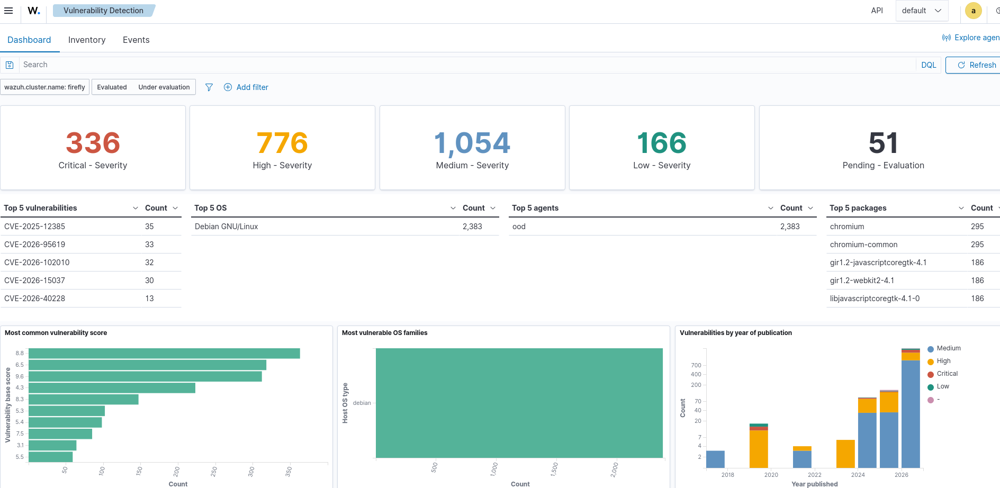

In [part 1](/homelab/wazuh-1/) I explained what a SIEM is, why you might want one and if you do - why Wazuh. This is the practical part.

## Installation choices

Wazuh server has several components: **wazuh-manager** (the analysis engine), **wazuh-indexer** (indexes and searches the logs), **wazuh-dashboard** (the web UI), and **filebeat** (sends logs from manager to indexer). The easiest way is to install all of them on one server. But you can also install them on separate servers and even replicate them. The distributed setup is for large installations. A single box can handle dozens of agents and at home I'll only have a few.

The options are the Docker/Kubernetes route or native system packages. I went with the latter, from Wazuh's own apt repository. For production deployments, I ran Wazuh on a dedicated physical machine. For the home experiment, I used the same route, except the machine is shared.

As usual with my home machines, I created Ansible roles: `wazuh_server` for Firefly and `wazuh_agent` for other Linux machines.

## Pinning the version

On home machines I install most packages with `state: latest`. Wazuh is one of the rare exceptions:

```yaml
- name: Install Wazuh server packages
  ansible.builtin.apt:
    name:
      - "wazuh-indexer={{ wazuh_server_version }}"
      - "wazuh-manager={{ wazuh_server_version }}"
      - "wazuh-dashboard={{ wazuh_server_version }}"
      - "filebeat={{ wazuh_server_filebeat_version }}"
    state: present
    update_cache: true
    allow_change_held_packages: true

- name: Hold Wazuh server packages at the pinned version
  ansible.builtin.dpkg_selections:
    name: "{{ item }}"
    selection: hold
  loop: [wazuh-indexer, wazuh-manager, wazuh-dashboard, filebeat]
```

There are two reasons to hold the upgrades. All the components should be updated at the same time and Wazuh recommends quite a complex procedure (although in my experience, a usual `apt upgrade` works fine, just make sure to verify your setup afterwards). Agents need to be upgraded after the server node(s) - manager is backwards compatible, but refuses connections from agents newer than itself. So there's a single `wazuh_version` variable shared by both roles. The second reason has to do with where the manager lives, which is the next section.

## Disk layout

Manager (and the agent) keeps everything - binaries, configuration, databases and logs - in `/var/ossec`. The indexer keeps its data separately, in `/var/lib/wazuh-indexer` by default, and that one is quite large, especially after a few months. Firefly's data disks are encrypted and only unlocked manually after boot (see [part 5 of the storage series](/home/nas-5/)), and I wanted to keep Wazuh's data there instead of leaving it on the small and unencrypted system disk.

For the indexer that was easy: the role just points OpenSearch's `path.data` at `/data/noshare/wazuh-indexer`, which is already on the encrypted btrfs subvolume.

For `/var/ossec` I created a dedicated btrfs subvolume on the same pool:

```bash
mount /dev/mapper/luks-btrfs1 /mnt/btrfs-root
btrfs subvolume create /mnt/btrfs-root/wazuh
umount /mnt/btrfs-root
mkdir -p /var/ossec
mount -o subvol=wazuh,nodev,noatime /dev/mapper/luks-btrfs1 /var/ossec
```

Since I use btrfs, one important step was to set the No_COW attribute on the indexer's directory. Copy on Write doesn't make much sense with database files and would seriously affect performance.

```yaml
- name: Create indexer data directory
  ansible.builtin.file:
    path: "{{ wazuh_server_indexer_data_dir }}"
    state: directory
    owner: wazuh-indexer
    group: wazuh-indexer
    mode: '0750'
    attributes: "{{ 'C' if wazuh_server_indexer_data_nocow else omit }}"
```

The new subvolume isn't available until the pool is unlocked, same as `/data/other` and `/data/noshare`, so it went into the same `BTRFS_SUBVOLUMES` array in `unlock-mount.sh`. One catch: the old script mounted every subvolume with the `noexec` option. That worked for all my previous needs, but `/var/ossec` also holds the manager's binaries. So entries can now optionally carry their own mount options, if they're not present, the default options apply:

```bash
BTRFS_DEFAULT_OPTIONS="nodev,noexec,noatime"
BTRFS_SUBVOLUMES=(
  "othervol:/data/other"
  "noshare:/data/noshare"
  # Wazuh manager's install dir - holds its binaries too, so no noexec
  "wazuh:/var/ossec:nodev,noatime"
)
```

This is the second reason for setting the package state to "hold": if unattended-upgrades ever updated `wazuh-manager` while the pool was still locked, it would unpack the new version into the empty mountpoint on the system disk, which would then be hidden when the real subvolume got mounted on top of it.

## Starting only after unlock

On Firefly Wazuh cannot start at boot. The startup commands go into the unlock script, where I already have Samba, Syncthing and a few other daemons. But I made the role configurable - it has a `wazuh_server_defer_autostart` switch, if it's set to False, it would start the daemons in the usual way instead.

```bash
SYSTEMD_SERVICES=(
  # ...
  # order matters: manager/Filebeat/dashboard all talk to the indexer
  "wazuh-indexer.service"
  "wazuh-manager.service"
  "filebeat.service"
  "wazuh-dashboard.service"
)
```

## Certificates and passwords

The four components connect over TLS, so the role runs Wazuh's `wazuh-certs-tool.sh` to generate a root CA and a set of certificates. It only runs once - regenerating would replace the CA everything trusts. My browser, obviously, won't trust that CA - it will warn about the risk. For the experimental setup, I can just accept an insecure certificate.

The indexer listens on `127.0.0.1` only. Filebeat and the dashboard that connect to it are on the same server. Binding to loopback also keeps OpenSearch out of its production mode.[^1] For the Wazuh API (port 55000) I kept the default (listen on all interfaces). Probably it can be bound to loopback too (agents don't use it, they talk to the manager on ports 1514 and 1515), but I haven't checked it yet.

Wazuh needs several passwords - at least one for human use, to log in to the dashboard (default account is simply called admin) and a few more for machine use, to authenticate connections between the components. The first run of the role runs Wazuh's password tool to generate the passwords and save them to a file in /var/ossec.[^2] That file doubles as the "already bootstrapped" marker: delete it, and the next run regenerates all passwords.

## Cutting down the noise

The default rule set causes a lot of false alerts. The first thing to do with a new installation is to spend some time editing `/var/ossec/etc/rules/local_rules.xml`, raising the level of low-value rules (e.g. repeated cron logs, routine sudo use from my own account) to a level below the alert threshold. You should still keep them, rather than disabling - these events can be useful for log correlation when you investigate a real problem. I edit the file by hand because it keeps changing during the first days. Once it becomes stable, I can add it to the Ansible role.

Disk usage is a concern if you have busy servers. Logs and indices can take a lot of space. Wazuh rotates and compresses its alert logs daily but never deletes them, so the role adds a daily cron job that prunes anything older than `wazuh_server_log_retention_days` (90 by default). The indices in the indexer get the same 90 days, through a retention policy (see the manual steps below) - by default they're kept forever.[^3]

## Adding agents

For Linux, the `wazuh_agent` role works on any Debian-based machine. It adds the same apt repo, installs the agent in the same version as the server components, and configures it to connect to the manager:

```yaml
- name: Install the Wazuh agent
  ansible.builtin.apt:
    name: "wazuh-agent={{ wazuh_agent_version }}"
    state: present
    update_cache: true
    allow_change_held_packages: true
  environment:
    WAZUH_MANAGER: "{{ wazuh_agent_manager_address }}"

- name: Point the agent at the manager
  ansible.builtin.replace:
    path: /var/ossec/etc/ossec.conf
    regexp: '(<client>[\s\S]*?<address>)[^<]*(</address>)'
    replace: '\g<1>{{ wazuh_agent_manager_address }}\g<2>'
  notify: Restart wazuh-agent

- name: Start the Wazuh agent and enable it at boot
  ansible.builtin.service:
    name: wazuh-agent
    state: started
    enabled: true
```

The manager address defaults to Firefly's IP from the Ansible inventory rather than a hostname, so agents will connect even if local DNS is down. On first start the agent enrols itself with the manager. Both roles optionally take an enrolment password, otherwise anything on the network that can reach port 1515 can register as an agent.

Windows machines get the agent installed by hand at the moment. One day I can add Ansible/WinRM setup for that.

My laptops often travel with me. When the agent can't connect to the manager, it will queue the logs and send them when it's on the same LAN again. The queue holds up to 5000 messages by default, which should be enough for a few days.

## Network devices

Network devices can't run an agent, but they can send syslog. Simply point them at Wazuh's manager IP on TCP or UDP 514. On the manager side, the role takes a list of allowed source IPs and appends a `<remote>` block of type `syslog` to `ossec.conf`. Doesn't give the depth an agent would (no file integrity monitoring, no process list, just whatever the device chooses to log), but it shows authentication attempts and configuration changes. Not perfect, but the usual monitoring a home router gets is "none at all", so that's already an improvement.

## Checking if it works

After the first `firefly.yml` playbook run, a few quick checks on Firefly:

```bash
# all four services up
systemctl is-active wazuh-indexer wazuh-manager filebeat wazuh-dashboard

# Filebeat can reach the indexer with its certificates and new password
filebeat test output

# indexer healthy, alerts arriving
curl -sk -u admin:<password> https://127.0.0.1:9200/_cluster/health?pretty
curl -sk -u admin:<password> "https://127.0.0.1:9200/_cat/indices/wazuh-alerts-*?v"
```

### Who watches the watchers?

And then, obviously, I logged in to the dashboard. There were already a few hundred alerts - before I'd added the first agent. That's because the manager also watches its own host: Firefly shows up as agent `000`. I also tried the old default logins (`admin`/`admin` on the dashboard, `wazuh`/`wazuh` on the API) to make sure they really were rejected.

Wazuh components need a long time to restart, and the dashboard answers with HTTP 503 until everything is ready. Don't be surprised if it takes a minute or two.

After running the playbook for my laptop, the agent showed up on the manager within a minute:

```
$ sudo /var/ossec/bin/agent_control -l
   ID: 000, Name: firefly (server), IP: 127.0.0.1, Active/Local
   ID: 001, Name: ood, IP: any, Active
```

## Vulnerability findings on Debian

Vulnerability section looks quite alarming on Debian. It's not so bad - some of that are false alerts, some - the same vulnerability counted many times, and the rest - not as dangerous as it seems.



The main source of confusion is how Debian fixes things. It doesn't upgrade a stable package to a new upstream release; it backports the fix and bumps only the Debian revision. `3.0.11-1~deb12u1` becomes `3.0.11-1~deb12u2`, and the upstream part (`3.0.11`) stays the same. Anything that compares just the upstream version against the CVE's "affected below 3.0.13" range (which is what NVD data says) will flag the fixed package as vulnerable. Wazuh is supposed to use Debian's security data for Debian packages, but when a package or CVE isn't mapped properly it can fall back to upstream ranges, and that's where the false positives come from.

The rest of the noise is technically correct, just not necessarily important:

- **Unfixed CVEs.** Debian marks plenty of minor issues as `no-dsa`, `ignored` or `postponed` - known, but not worth a security update in stable. Wazuh reports them with no fixed version, and there's nothing to do about them except wait for the next point release or the next Debian.
- **Kernel bugs.** There are thousands of CVEs for the Linux kernel, but that's because it also contains numerous drivers in addition to the real operating system. Most of the bugs affect hardware you don't have.
- **Repeated installs.** Every installed `linux-image-*` package gets reported, including ones for kernels that aren't running any more - and it's a common practice to keep the previous kernel in case you encounter problems with the new one. Or if you use Python virtual environments, you'll have the same library installed in many places. Could be real issues, but the number of vulnerabilities found is inflated.
- **Debian Testing.** Testing doesn't get security support from the Debian security team, so the data for it is much less precise. I expect a lot more noise on my laptop which runs Debian Testing than on Firefly which runs Stable.

Remember that Wazuh also checks **software not installed through apt.** Which is great if you're a Python developer (or have to take care of some), as Pip packages tend to never get updated.

### Verifying the findings

To check a single finding:

```bash
# exact installed version, including the Debian revision
dpkg -l openssl

# was the fix backported? the changelog lists the CVEs it fixes
apt changelog openssl | grep CVE-2024-XXXXX
```

Then compare with the CVE's page on the [Debian Security Tracker](https://security-tracker.debian.org/tracker/) (`https://security-tracker.debian.org/tracker/CVE-2024-XXXXX`), which lists the fixed version for each Debian release. If the installed version is the same or newer, it's a false positive.

For a second opinion on the whole machine, `debsecan` works straight from the Debian Security Tracker:

```bash
apt install debsecan
# only CVEs that already have a fix available - i.e. the ones that need an upgrade
debsecan --suite $(lsb_release -cs) --only-fixed
```

For my home machines, I install all the updates anyway and if a patched version isn't available, there's nothing I can do. For production, things are different. Developers and sysadmins often want to keep old versions for compatibility, while the security team wants to have everything patched. Many security certifications require you to keep a list of vulnerable software - if you can't patch it, you need to at least be aware. Wazuh can be a great help, but as you can see, you need to verify the results.

## What's still manual

The roles cover most of the setup, but a few steps stayed outside Ansible. Mostly because they would be a pain to automate and they only happen once:

1. **Creating the `wazuh` subvolume** (the commands in "Disk layout" above). Just like the rest of my disk and filesystem setup, it was done manually.
2. **Unlocking Firefly before running the playbook.** The play refuses to run until `/var/ossec` and `/data` are mounted, so after a reboot it's `ssh firefly`, `sudo /unlock-mount.sh`, type the passphrase. That's intentional.
3. **First login.** The dashboard is on `https://firefly/`, with a certificate signed by Wazuh's own freshly generated CA, so the browser complains until I either accept it or import `root-ca.pem`. The `admin` password is in the passwords file saved under `/var/ossec`, I saved it in my KeePassXC.
4. **Index retention.** An Index State Management policy that deletes `wazuh-alerts-*` and `wazuh-archives-*` indices once they're 90 days old - same as the alert log retention on disk. Its `ism_template` attaches it to each new daily index automatically; the indices that already existed needed attaching once by hand. I created it with two `curl` calls against the indexer's API (`PUT _plugins/_ism/policies/...`, then `POST _plugins/_ism/add/wazuh-alerts-*`), but the dashboard's Index Management → Index Policies page does the same. The role could do it too, but it's a one-time change.
5. **Rule tuning** in `local_rules.xml`, as described above.
6. **Pointing the router and switch at Firefly** for syslog, in their own admin UIs, and adding their IPs to `wazuh_server_syslog_allowed_ips` in the playbook.
7. **Windows agents**, installed from the MSI by hand.
8. **Upgrades.** Set `wazuh_version`, run `firefly.yml` first, then upgrade the agents.

## Possible next steps

Right now Wazuh mostly runs with its defaults. It can do a lot more:

- **More agents.** Other machines on the LAN are obvious. The more interesting case is the mikr.us VPS: it's the only machine I have that's exposed to the internet, so it's the one most worth watching. The catch is that its agent would have to reach Firefly from outside, so either port 1514 gets forwarded through the router (over my dead body) or the VPS connects over a VPN (maybe one day I'll decide it's worth it).
- **Realtime integrity monitoring for some files.** By default Wazuh checks system directories every 12 hours. I could add `realtime="yes"` on the most important files and directories, e.g. `/etc/ssh`, `/etc/sudoers.d`, `/usr/local/bin`, `/unlock-mount.sh`, Samba and NFS config - so a modification raises an alert within seconds instead of half a day later. Realtime monitoring of all files would kill this server.
- **Active response.** Wazuh can react, not just alert: for example, block an IP with `firewall-drop` after repeated failed logins. It's also a great way to lock yourself out if you make a mistake in the rule, but on the VPS it would be genuinely useful.
- **Custom checks.** With a `<localfile>` of type `command` (or `full_command`), the agent runs a command on a schedule and Wazuh applies rules to the output. That would let it alert on things specific to my machines: a `/data` volume that isn't mounted, a failed or overdue SnapRAID sync, a Borg backup that didn't run, SMART errors from `smartctl`, a btrfs pool reporting device errors. One might say it's abusing the idea of SIEM.
- **Application logs.** Jellyfin, Samba (with its `full_audit` module for file access), Home Assistant and nginx on the VPS all write logs that Wazuh could read and alert on, once I write a decoder and a few rules for the ones it doesn't know yet.
- **Docker.** The `docker-listener` module records container events - started, stopped, created, a new image pulled - which on Firefly would mostly tell me when something restarted without me asking for it.
- **Notifications.** At the moment I only see alerts if I open the dashboard - which I don't do often. Wazuh can email high-level alerts, or send them anywhere with a webhook through its integrations (for example to ntfy on my phone), so that something important doesn't wait until I happen to check.
- **auditd.** On Linux agents, Wazuh can read `auditd` logs, which can be configured to record every command run as root. Example configs are provided in Wazuh's docs. Such a setup could be useful on the servers, less so on a laptop I use all day.
- **YARA.** YARA is a pattern-matching tool for malware: a rule describes text strings, byte sequences or regular expressions typical for a malware family (plus some rules to catch new variants). Wazuh doesn't scan files with YARA by itself, only with custom rules, but it's a very common setup: file integrity module detects a new or modified file, and an active-response script on the agent then sends it to YARA, which can then trigger an alert. The obvious place for it is the Downloads folder on the laptops. Wazuh's own example pulls its YARA rules from Nextron's Valhalla feed, but any rule set works. It only alerts; deleting or quarantining a matching file would be a separate active response.

### Impossible next steps

Wazuh can also pull audit logs from cloud services, and two of those looked tempting because I use them - Microsoft 365 and GitHub. Neither works with personal accounts:

- **Microsoft 365** is read through the Office 365 Management Activity API, which needs an app registered in an organisation's Entra ID (Azure AD) tenant, with admin consent for the activity-feed permissions. A personal or family Microsoft 365 subscription has no tenant, only a business subscription (even a one-person one) creates it.
- **GitHub** is read through the audit log API, which exists only for organisations, and only for those on GitHub Enterprise Cloud. A personal account's security log can be viewed on the website, but there's no API Wazuh could read it from.

[^1]: OpenSearch can run in "development" or "production" mode. If it only listens on loopback, it obviously can't form a cluster with other machines, so it runs in the development mode. If it's configured to listen on a LAN IP or all interfaces, it starts in production mode. On startup it runs a set of checks: `vm.max_map_count` of at least 262144 (Debian's default used to be much lower but since Trixie it has more than enough), at least 65535 open file descriptors, a high enough thread limit, the same initial and maximum JVM heap size, and working memory locking if `bootstrap.memory_lock` is enabled. If it's running in the development mode, it will only log failed checks; in production mode it refuses to start. The checks are there for a reason, they ensure optimal settings for good performance. But for a homelab experiment, I don't care.

[^2]: The password file is stored on an encrypted volume and readable only by root. In my opinion it's OK for a homelab experiment. For production it's definitely not enough. There are other options possible: moving the logins into a password manager and deleting the file; encrypting the file; generating the passwords myself and keeping them in Ansible Vault; keeping passwords in a secrets manager such as HashiCorp Vault or OpenBao; using a Single Sign-On system to log in to the dashboard.

[^3]: Disk space isn't the only limit. OpenSearch allows 1000 open shards per node by default (`cluster.max_shards_per_node`). Wazuh creates a new alerts index every day (which by default takes 3 shards), plus a few weekly indices (1 shard each). In about 300 days you run out of shards. When it happens, the next day's index can't be created and new alerts silently stop showing up in the dashboard (the manager still writes them to `alerts.json`). I found out the hard way in a production setup in the past: we wanted to keep a year of logs and had plenty of disk space for it, but not enough shards. The options are: fewer shards per index (on a single node, one shard per index is enough) or raising the limit. At home I use short retention, so I shouldn't run out of shards.
